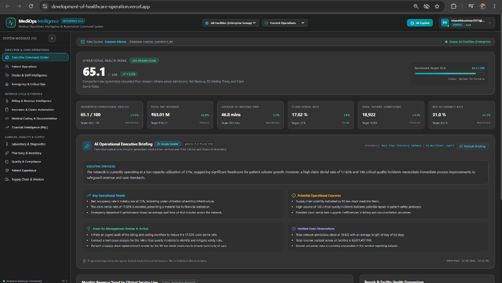
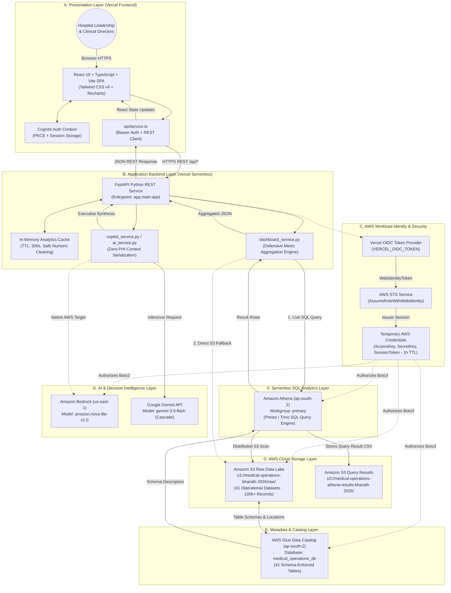
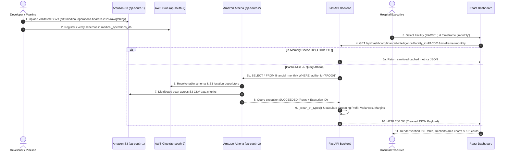
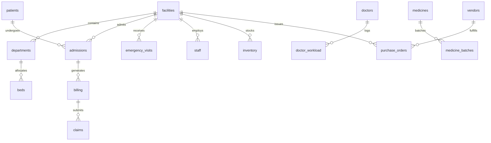

<div align="center">

# 🏥 MedOps Intelligence & Automation

### Healthcare Operations Intelligence Dashboard with Decision Analytics

*An enterprise-grade, cloud-native healthcare operations intelligence platform that centralizes distributed hospital data across 5 regional facilities to drive operational analytics, executive KPI monitoring, serverless cloud query execution, and AI-assisted decision intelligence.*

---

[](https://development-of-healthcare-operation.vercel.app)
[](https://github.com/kummariBharath/Development-of-Healthcare-Operations-Intelligence-Dashboard-with-Decision-Analytics)
[](https://www.python.org/)
[](https://fastapi.tiangolo.com/)
[](https://react.dev/)
[](https://www.typescriptlang.org/)
[](https://vitejs.dev/)
[](https://aws.amazon.com/cognito/)
[-569A31?style=for-the-badge&logo=amazons3&logoColor=white)](https://aws.amazon.com/s3/)
[-8C4FFF?style=for-the-badge&logo=amazonwebservices&logoColor=white)](https://aws.amazon.com/glue/)
[](https://aws.amazon.com/athena/)
[-0052CC?style=for-the-badge&logo=amazonwebservices&logoColor=white)](https://aws.amazon.com/bedrock/)
[-059669?style=for-the-badge)](#13-testing-validation--audit-remediation)
[](#license)

<br/>



</div>

---

## 📑 Table of Contents

- [1. Executive Overview](#1-executive-overview)
- [2. Operational Challenge vs. Platform Solution](#2-operational-challenge-vs-platform-solution)
- [3. End-to-End System Architecture](#3-end-to-end-system-architecture)
- [4. Vercel Deployment & Workload Identity Architecture](#4-vercel-deployment--workload-identity-architecture)
- [5. AWS Cloud Data Pipeline & Multi-Region Storage](#5-aws-cloud-data-pipeline--multi-region-storage)
- [6. Resilient Multi-Tier Analytics & Data Source Hierarchy](#6-resilient-multi-tier-analytics--data-source-hierarchy)
- [7. Frontend → Backend → Cloud Execution Flow](#7-frontend--backend--cloud-execution-flow)
- [8. AI Decision Intelligence: Provider-Independent Architecture](#8-ai-decision-intelligence-provider-independent-architecture)
- [9. Authentication & User Access Architecture (Amazon Cognito PKCE)](#9-authentication--user-access-architecture-amazon-cognito-pkce)
- [10. Security Perimeter & Credential Isolation](#10-security-perimeter--credential-isolation)
- [11. Healthcare Data Model (41 Relational Tables)](#11-healthcare-data-model-41-relational-tables)
- [12. Analytics & Verified Metric Computation Layer](#12-analytics--verified-metric-computation-layer)
- [13. Master Implemented Metrics Reference](#13-master-implemented-metrics-reference)
- [14. Complete Dashboard Module Suite (21 Modules)](#14-complete-dashboard-module-suite-21-modules)
- [15. Internal Developer Diagnostics (AWS Cloud Services Hub)](#15-internal-developer-diagnostics-aws-cloud-services-hub)
- [16. REST API Specification (All 22 Endpoints)](#16-rest-api-specification-all-22-endpoints)
- [17. Technology Stack](#17-technology-stack)
- [18. Repository Structure](#18-repository-structure)
- [19. Testing, Validation & Audit Remediation](#19-testing-validation--audit-remediation)
- [20. Getting Started & Local Setup](#20-getting-started--local-setup)
- [21. AWS Cloud Infrastructure Deployment Guide](#21-aws-cloud-infrastructure-deployment-guide)
- [22. System Limitations & Future Engineering Roadmap](#22-system-limitations--future-engineering-roadmap)
- [23. Engineering Principles & Project Truthfulness](#23-engineering-principles--project-truthfulness)

---

## 1. Executive Overview

Modern healthcare delivery networks generate colossal volumes of operational and clinical data across emergency departments, inpatient wards, surgical suites, pharmacy distribution points, revenue cycle billing platforms, and medical supply chains. However, hospital leadership routinely struggles with:

* **Siloed Departmental Systems**: Clinical EHRs, Laboratory Information Management Systems (LIMS), ERPs, and billing platforms operate in isolation without centralized analytics.
* **Delayed Retrospective Reporting**: Hospital administration relies heavily on delayed, manually compiled spreadsheets that hinder timely operational interventions.
* **Workforce Overburden & Capacity Bottlenecks**: Doctor and nursing schedules struggle to dynamically adapt to emergency spikes and unpredictable bed occupancy.
* **Revenue Leakage**: Coding discrepancies, insurance claim denials, and prolonged unbilled accounts receivable deplete operating margins.

**MedOps Intelligence** solves this fundamental operational gap. It serves as a unified healthcare operations intelligence platform that centralizes distributed hospital data across 5 regional healthcare facilities. Deployed globally on **Vercel** with a serverless **AWS data engineering and AI backend**, the platform transforms raw transactional healthcare records into actionable executive command visibility, decision analytics, and automated operational intelligence.

### Architectural Core: Implemented vs. Roadmap

To maintain strict engineering transparency, the table below establishes the explicit boundary between currently implemented production capabilities and planned roadmap items:

| Platform Capability Domain | Currently Implemented (Production) | Planned / Future Roadmap |
| :--- | :--- | :--- |
| **Application Hosting** | Hosted entirely on **Vercel** (Vite frontend + FastAPI backend service via `vercel.json` rewrites). | Dedicated multi-region edge clustering. |
| **AWS Cloud Workload Identity** | Zero static keys in cloud; **Vercel OIDC** token dynamically exchanged for temporary AWS credentials via **AWS STS** (`AssumeRoleWithWebIdentity`). | Cross-account IAM role assumption for external healthcare partners. |
| **User Authentication** | **Amazon Cognito Managed Login** with OAuth 2.0 Authorization Code Grant and **PKCE**; session stored in browser `sessionStorage`. | Multi-tier granular RBAC backend route enforcement (currently groups mapped to user profile). |
| **Primary Data Source** | **Amazon Athena** serverless SQL executing against **AWS Glue Data Catalog** (`medical_operations_db`) over **Amazon S3** data lake. | Snappy-compressed Apache Parquet automated conversion via AWS Glue ETL jobs. |
| **Resilient Fallback** | Automated 5-tier fallback hierarchy: In-memory cache (300s TTL) → Amazon Athena → S3 direct read → Local CSV fallback → Defensive empty states. | Distributed Redis caching layer across edge regions. |
| **AI Decision Copilot** | **Provider-Independent AI Architecture**: Active Google Gemini (`gemini-3.5-flash`) adapter with Amazon Bedrock (`amazon.nova-lite-v1:0` in `us-east-1`) architecture. Strict zero-PHI prompt serialization and deterministic analytics fallback. | Fine-tuned clinical operational LLMs and multi-agent workflow coordinators. |
| **User-Facing Modules** | **20 dedicated operational modules** in primary navigation across 5 functional operational groups + Enterprise Drilldown Matrix. | External third-party marketplace modules and bidirectional HL7/FHIR live connectors. |
| **Developer Diagnostics** | Preserved internal `AWSCloudServicesHub.tsx` for direct Glue catalog schema inspection and interactive Athena SQL execution. | Embedded CloudWatch log streamer and Athena query cost optimizer console. |
| **Technical Documentation** | Complete 40-page technical handbook and demo guide generated in `docs/MedOps_Internal_Demo_Technical_Guide.pdf`. | Automated interactive architecture wiki. |

---

## 2. Operational Challenge vs. Platform Solution

| Healthcare Operational Challenge | MedOps Intelligence Architectural Solution |
| :--- | :--- |
| **Fragmented Departmental Data** | Centralized, schema-enforced AWS Data Lake housing 41 relational operational domains in Amazon S3 (`ap-south-1`). |
| **Manual & Latent Reporting** | Automated serverless SQL queries executed via Amazon Athena delivering aggregated metrics on demand. |
| **Executive Visibility Gaps** | Unified Executive Command Center aggregating hospital-wide throughput, census, and revenue across 5 facilities. |
| **Unpredictable Bed Utilization** | Dynamic active admission date-interval overlap algorithm calculates real-time census against licensed bed capacity. |
| **Workforce Scheduling Mismatches** | Doctor & Staff Intelligence correlating shift attendance, overtime hours, patient-to-staff ratios, and workload scores. |
| **Claims Denials & Financial Leakage** | Revenue Cycle Analytics uncovering top denial reason codes (CO-16, CO-197), outstanding A/R, and clean claim rates. |
| **Critical Stockouts & Supply Delays** | Pharmacy & Inventory Intelligence monitoring automated reorder thresholds, dynamic 90-day batch expirations, and stock value. |
| **Quality & Privacy Auditing** | Quality & Compliance module tracking authentic Data Privacy audit scores, infection incident rates per admission, and medication errors. |
| **Reactive Patient Experience Oversight** | Multi-channel Patient Experience analytics tracking Net Promoter Scores (NPS), CSAT ratings, and feedback sentiment with graceful missing-data handling. |

---

## 3. End-to-End System Architecture

The MedOps Intelligence platform follows a decoupled, cloud-native architecture combining a Vercel-hosted presentation and API layer with an AWS serverless data lake, query execution engine, and generative AI copilot:



> [!IMPORTANT]
> **Zero Client-Side Credential Exposure**: The browser-based React client never receives AWS access keys, secret keys, or IAM session tokens. All Athena queries, Glue metadata inspections, and AI model invocations are mediated strictly through authenticated FastAPI backend endpoints.

---

## 4. Vercel Deployment & Workload Identity Architecture

The entire MedOps Intelligence platform is deployed and served through **Vercel**, uniting the modern React frontend and the FastAPI backend service within a single unified domain and deployment lifecycle:

```
Browser
   ↓
Vercel Edge Network
   ├── React + Vite Frontend (Static Assets & Client Routing)
   └── FastAPI Backend Service (Python Serverless Runtime)
          ↓
   Vercel OIDC Token (VERCEL_OIDC_TOKEN)
          ↓
   AWS STS AssumeRoleWithWebIdentity (role: vercel-medical-operations)
          ↓
   Temporary AWS Credentials (1-Hour Session Token)
          ↓
   Amazon S3 · AWS Glue · Amazon Athena · Amazon Bedrock
```

### Key Deployment Characteristics

* **Unified Vercel Hosting**: Vercel hosts both the static React frontend and the Python FastAPI backend service configured via `vercel.json` rewrites (`/api/*` routes to the backend service).
* **AWS as Cloud Data Platform**: AWS provides data lake storage (S3), schema cataloging (Glue), serverless SQL query execution (Athena), and AI models (Bedrock).
* **Vercel OIDC Workload Identity**: In cloud production on Vercel, the backend automatically acquires a short-lived OIDC JWT from the Vercel execution environment. It presents this token to AWS STS via `assume_role_with_web_identity` to obtain scoped, temporary AWS credentials. Zero static AWS keys are stored in the cloud.
* **Local Development Fallback**: When running locally without active AWS credentials, the backend cleanly resolves local CSV datasets from `dataset/medical_operations_core_v9_100k/` without throwing 500 errors.

---

## 5. AWS Cloud Data Pipeline & Multi-Region Storage

MedOps implements an intentional multi-region cloud data architecture:

| Component | AWS Service | Configured Region | Configuration Variable |
| :--- | :--- | :--- | :--- |
| **Data Lake Storage** | Amazon S3 | **`ap-south-1`** (Mumbai) | `AWS_S3_REGION` (default: `ap-south-1`), `AWS_S3_BUCKET` (`medical-operations-bharath-2026`) |
| **Data Catalog** | AWS Glue | **`ap-south-2`** (Hyderabad) | `AWS_DATA_REGION` (default: `ap-south-2`), `AWS_GLUE_DATABASE` (`medical_operations_db`) |
| **Serverless SQL** | Amazon Athena | **`ap-south-2`** (Hyderabad) | `AWS_DATA_REGION` (default: `ap-south-2`), `AWS_ATHENA_WORKGROUP` (`primary`) |
| **AI Inference** | Amazon Bedrock | **`us-east-1`** (N. Virginia) | `AWS_BEDROCK_REGION` (`us-east-1`), `AWS_BEDROCK_MODEL` (`amazon.nova-lite-v1:0`) |
| **User Identity** | Amazon Cognito | **`us-east-1`** (N. Virginia) | `us-east-1_fs4PnK0gh` (User Pool ID), `241i1ehcindfsu1d77953or31u` (Client ID) |

### 8-Stage Data Lifecycle Flow



---

## 6. Resilient Multi-Tier Analytics & Data Source Hierarchy

To guarantee maximum system availability across varied network, cloud, and local environments, MedOps Intelligence implements an automated **five-tier fallback hierarchy** inside `_load_table()`:

```
[ Tier 1: In-Memory Cache (TTL: 300s) ]
         │ (Miss / Expired)
         ▼
[ Tier 2: Amazon Athena Serverless SQL (Primary Live Analytical Source) ]
         │ (Query Timeout / Throttled / Cloud Offline)
         ▼
[ Tier 3: Direct Amazon S3 Bucket Read (raw/{table}/{table}.csv via Boto3) ]
         │ (Bucket Inaccessible / Local Offline Dev)
         ▼
[ Tier 4: Local CSV Dataset Fallback (dataset/medical_operations_core_v9_100k/) ]
         │ (Missing Disk File)
         ▼
[ Tier 5: Defensive Empty DataFrame (_safe_sum, _safe_mean -> 'N/A' states) ]
```

1. **In-Memory Cache (First Priority)**: Repeated queries within a 300-second window are served instantly from thread-safe in-memory DataFrames, reducing Athena scan overhead and query latency to sub-10ms.
2. **Amazon Athena (Primary Live Source)**: Dispatches distributed Presto/Trino SQL queries against the AWS Glue Catalog. Auto-detects and repairs generic `col0..colN` headers when crawlers do not promote header rows.
3. **Direct S3 Read Fallback**: If Athena query execution encounters a throttling or connectivity barrier, analytical services fall back to reading the raw CSV directly from `s3://medical-operations-bharath-2026/raw/{table}/{table}.csv`.
4. **Local Development Fallback**: When running locally without active AWS credentials, the backend resolves the dataset from `dataset/medical_operations_core_v9_100k/` for offline developer productivity.
5. **Defensive Empty State**: If all data sources fail, returns an empty DataFrame. Mathematical aggregations use `_safe_sum()` and `_safe_mean()`, surfacing explicit "N/A" states rather than 500 crashes.

---

## 7. Frontend → Backend → Cloud Execution Flow

Every user action follows a strictly validated, decoupled execution pipeline:

1. **User Interaction**: The user selects a facility (e.g., `FAC001`) and timeframe (e.g., `Monthly`) in the `Header.tsx` controls.
2. **React State Update**: Active module component sets loading state and renders animated skeleton placeholders.
3. **API Client Request**: `src/services/apiService.ts` dispatches a `fetch()` request, automatically attaching the Cognito `Authorization: Bearer <id_token>` header.
4. **FastAPI Routing**: The corresponding router in `backend/app/routes/dashboard.py` validates parameters and delegates to `backend/app/services/dashboard_service.py`.
5. **Data Retrieval**: `_load_table()` evaluates cache, Athena, S3, or local CSV fallbacks.
6. **Defensive Transformation**: `_clean_df_types()` shields protected IDs, strips currency formatting, and casts metrics to native 64-bit numerics.
7. **Business Logic Computation**: Mathematical formulations (active bed occupancy, clean claim rates, EBITDA proxy, budget variances) are computed.
8. **JSON Serialization**: FastAPI serializes a validated dictionary into HTTP 200 JSON, replacing NaNs with `null` or formatted strings.
9. **UI Re-rendering**: React receives the payload; Recharts plots responsive SVG charts; metric cards display verified numbers and data source provenance badges.

---

## 8. AI Decision Intelligence: Provider-Independent Architecture

MedOps features a **Provider-Independent AI Architecture** designed to seamlessly bridge cloud AI inference with enterprise healthcare data telemetry:

```
React Frontend (Executive Command Center / AI Copilot Drawer / AI Agent Tab)
                             │
                             ▼
                 FastAPI Backend Service Layer
                             │
              ┌──────────────┴──────────────┐
              │                             │
              ▼                             ▼
    AWS Analytics Pipeline        Provider-Independent AI Service
    (S3 / Glue / Athena)          (app/services/ai_service.py)
              │                             │
              ▼                     ┌───────┴───────┐
    Verified Aggregate Metrics     │               │
              │                     ▼               ▼
              └──────────────> [Google Gemini] [Amazon Bedrock]
                               (Active Adapter) (Native Target)
                                    │               │
                                    └───────┬───────┘
                                            │
                                            ▼
                              AI Executive Summary & Copilot
```

### 1. Active Adapter: Google Gemini with Bedrock Native Target
Amazon Bedrock model access enablement is currently pending cloud-side AWS account review. To deliver immediate, production-grade operational intelligence, the **Google Gemini API** (`gemini-3.5-flash`) is integrated as the active operational provider via Google's official Python SDK (`google-genai`).
* **Zero AWS Regression**: S3 data storage, AWS Glue Data Catalog, Amazon Athena serverless queries, and Cognito authentication remain 100% active and untouched.
* **Provider-Independent Adapter**: An abstraction layer (`BaseAIProvider`, `GeminiProvider`, `BedrockProvider`) isolates provider specifics from healthcare business logic. Switching providers requires changing only `AI_PROVIDER=bedrock` in `backend/.env`.

### 2. Strict Zero-PHI Data Grounding Policy
Under no circumstances does MedOps transmit Protected Health Information (PHI) to external LLM APIs.
* **Aggregate Only**: Prompts receive **strictly high-level aggregate metrics** (total admissions, ALOS, collections, denial rates, ED wait times, occupancy %).
* **Zero Identifiers**: Zero patient names, medical record numbers (MRNs), dates of birth, social security numbers, or clinical chart notes are ever included in prompt payloads.

### 3. Resilient Deterministic Analytics Fallback
If public AI APIs experience rate limits (429), model retirement, or network timeouts (503), the system cascades across three candidate models (`gemini-3.5-flash` → `gemini-3.8-flash` → `gemini-flash-latest`) and automatically activates **Deterministic Analytics Mode**. The backend synthesizes structured operational insights directly from verified telemetry without crashing the dashboard.

---

## 9. Authentication & User Access Architecture (Amazon Cognito PKCE)

The platform cleanly separates **User Identity** from **AWS Workload Identity**:

```
User
  ↓
Amazon Cognito Managed Login (Hosted UI)
  ↓
Authorization Code Grant + PKCE (Proof Key for Code Exchange)
  ↓
Cognito Callback (/callback)
  ↓
React Authentication Context (AuthContext.tsx)
  ↓
Session Storage (ID Token & Access Token, Tab-Isolated)
  ↓
Authenticated MedOps Application Shell
```

* **Region**: `us-east-1`.
* **User Pool ID**: `us-east-1_fs4PnK0gh`.
* **Client ID**: `241i1ehcindfsu1d77953or31u` (Public Client, Secret-Free).
* **Supported Cognito User Groups**: `ADMIN`, `HOSPITAL_ADMIN`, `DOCTOR`, `ANALYST`, and `VIEWER`.
* **Session Storage Isolation**: Tokens are stored strictly in browser `sessionStorage`, isolating sessions per tab and avoiding persistent `localStorage` vulnerabilities.

---

## 10. Security Perimeter & Credential Isolation

* **Zero Static AWS Keys in Cloud**: In production on Vercel, the backend uses Vercel OIDC tokens exchanged via AWS STS (`AssumeRoleWithWebIdentity`) for 1-hour temporary credentials.
* **Browser Isolation**: The React client never receives AWS credentials or database connection strings. All cloud queries are brokered through FastAPI.
* **Secrets Management**: Backend environment variables are managed via `backend/.env`, strictly excluded from version control in `.gitignore`.
* **Safe Numeric Cleaning**: All conversions use `_to_num()`, `_safe_sum()`, and `_safe_mean()`, stripping currency symbols and replacing NaNs with safe defaults to prevent server crashes.
* **Regulatory Truthfulness**: The platform provides a Quality & Compliance module auditing data privacy practices. However, MedOps makes zero unsubstantiated claims of formal HIPAA or SOC2 regulatory certification.

---

## 11. Healthcare Data Model (41 Relational Tables)

MedOps centralizes 41 relational healthcare tables registered in AWS Glue Data Catalog (`medical_operations_db`):



### Table Domain Classification (41 Datasets Total)

1. **Administrative & Infrastructure (4)**: `facilities`, `departments`, `beds`, `bed_movements`
2. **Patient Encounters & Flow (7)**: `patients`, `admissions`, `discharge_records`, `appointments`, `emergency_visits`, `patient_flow_events`, `icu_stays`
3. **Clinical Workforce & Staffing (7)**: `doctors`, `staff`, `doctor_workload`, `staff_attendance`, `staff_workload`, `nurse_shifts`, `surgeries`
4. **Revenue Cycle & Financial (4)**: `billing`, `claims`, `financial_monthly`, `financial_expenses`
5. **Diagnostics & Laboratory (4)**: `lab_orders_results`, `lab_samples`, `lab_tests`, `lab_equipment`
6. **Pharmacy & Inventory (6)**: `medicines`, `medicine_batches`, `inventory`, `inventory_transactions`, `prescriptions`, `pharmacy_dispensing`
7. **Quality, Compliance & Safety (5)**: `quality_audits`, `quality_incidents`, `corrective_actions`, `patient_feedback`, `patient_complaints`
8. **Supply Chain & Procurement (4)**: `vendors`, `vendor_performance`, `purchase_orders`, `supply_chain_purchase_orders`

---

## 12. Analytics & Verified Metric Computation Layer

The analytics engine applies verified mathematical formulations across underlying datasets:

### 1. Active Inpatient Bed Occupancy Rate (%)
Rather than counting historical cumulative admissions, the occupancy calculation evaluates strictly active admissions overlapping the reference evaluation date:
$$\text{Occupancy Rate} = \left(\frac{\text{Active Admissions as of Reference Date}}{\text{Total Licensed Operational Bed Capacity}}\right) \times 100$$
Where an admission is active if:
$$\text{admission\_date} \le \text{ref\_date} \quad \text{AND} \quad (\text{discharge\_date IS NULL} \;\lor\; \text{discharge\_date} > \text{ref\_date})$$

### 2. Operating Profit (EBITDA Proxy) & Variances
$$\text{Operating Profit} = \text{Monthly Operating Revenue} - \text{Total Operating Expenses (OpEx)}$$
$$\text{Operating Margin (\%)} = \left(\frac{\text{Operating Profit}}{\text{Operating Revenue}}\right) \times 100$$
$$\text{Revenue Budget Variance} = \text{Actual Revenue} - \text{Budgeted Revenue}$$
$$\text{Cost Budget Variance} = \text{Budgeted Cost} - \text{Actual Cost}$$

### 3. Claims Denial Rate & Clean Claim Rate
$$\text{Denial Rate (\%)} = \left(\frac{\text{Count of Denied Claims}}{\text{Total Claims Submitted}}\right) \times 100$$
$$\text{Clean Claim Rate (\%)} = \left(\frac{\text{Claims Approved on Initial Submission}}{\text{Total Claims Submitted}}\right) \times 100$$

### 4. Quality & Compliance Formulations
* **Data Privacy Compliance Score**: Mean of `compliance_score` for records where `audit_type = 'Data Privacy'` in `quality_audits.csv`. Honestly labeled *Data Privacy Compliance* rather than claiming unverified formal HIPAA accreditation.
* **Infection Incident Rate**: Evaluated per admission denominator:
  $$\text{Infection Incident Rate (\%)} = \left(\frac{\text{Total Infection Incidents}}{\text{Total Inpatient Admissions in Period}}\right) \times 100$$
* **Medication Errors**: Separates *Today's Errors* (matching current reference date) from the *Reporting Period Total*.

### 5. Supply Chain: Average Vendor Quality Score
Replaces the unsupported Physical Defect Rate. Calculated as:
$$\text{Avg Vendor Quality Score} = \text{mean}(\text{quality\_score}) \quad \text{from } \texttt{vendor\_performance.csv}$$

### 6. Patient Experience: NPS & CSAT
* **Net Promoter Score (NPS)**: $\% \text{Promoters (rating 9-10)} - \% \text{Detractors (rating 1-6)}$ (range: -100 to +100).
* **CSAT Score (%)**: $(\text{Satisfied Responses} / \text{Total Responses}) \times 100$.
* **Overall Rating**: Mean of `overall_rating` on a 1.0–5.0 clinical scale (NOT a percentage).
* **Missing-Data Behavior**: Surfaces explicit `'N/A (No Feedback)'` rather than misleading 0.0 scores when survey counts are zero.

### 7. Pharmacy: Dynamic 90-Day Rolling Expiration
$$\text{Expiring Batches (90 Days)} = \text{count}(\text{expiry\_date} \text{ BETWEEN } \text{ref\_date} \text{ AND } \text{ref\_date} + 90 \text{ days})$$

---

## 13. Master Implemented Metrics Reference

| Metric Name | Module | Source Table & Columns | Exact Mathematical Formula | Verified Example | Implementation Caveats |
| :--- | :--- | :--- | :--- | :--- | :--- |
| **Bed Occupancy Rate** | Executive / Patient Ops | `admissions`, `beds` | `(Active Admissions / Total Beds) * 100` | 84.2% (421 / 500 beds) | Evaluates active admission date overlap; excludes past discharges. |
| **Average Length of Stay** | Patient Operations | `admissions` | `sum(length_of_stay_days) / count(discharges)` | 4.8 Days | Evaluates discharged patients to prevent ongoing-stay truncation bias. |
| **Emergency Wait Time** | Emergency Ops | `emergency_visits` | `mean(wait_time_minutes)` | 28.4 Mins | Door-to-doctor elapsed time; filters out unclosed visits (> 1440m). |
| **Gross Billed Revenue** | Billing / Financial | `billing` | `sum(gross_amount)` | $14,250,800 | Raw hospital chargemaster list charges before contractual discounts. |
| **Net Billed Revenue** | Billing / Financial | `billing` | `sum(gross_amount - discount_amount)` | $11,400,640 | Expected billings after contractual deductions with payers. |
| **Net Collected Revenue** | Financial (P&L) | `billing`, `financial_monthly` | `sum(paid_amount)` | $9,850,200 | Actual cash collected; excludes outstanding accounts receivable. |
| **Operating Profit (EBITDA)** | Financial (P&L) | `financial_monthly` | `Operating Revenue - Operating Expenses` | +$1,420,500 (14.4% margin) | Direct operational ledger variance; labeled EBITDA proxy. |
| **Revenue Budget Variance** | Financial (P&L) | `financial_monthly` | `Actual Revenue - Budgeted Revenue` | +$240,000 (+2.5%) | Positive indicates favorable top-line revenue performance. |
| **Claims Denial Rate** | Claims Automation | `claims` | `(Denied Claims / Total Claims) * 100` | 8.4% (168 / 2,000 claims) | Claim status 'Denied' or 'Rejected' or denied_amount > 0. |
| **Clean Claim Rate** | Claims Automation | `claims` | `(First-Pass Paid Claims / Total Claims) * 100` | 88.2% (1,764 / 2,000) | Claims adjudicated without manual appeals or re-submissions. |
| **Physician Workload Score** | Doctor & Staff | `doctor_workload` | `mean(workload_score)` | 74.2 / 100 | Composite index of appointments, surgeries, and rounds. |
| **Staff Overtime Rate** | Doctor & Staff | `staff_attendance` | `(Total OT Hours / Scheduled Hours) * 100` | 6.8% (340 OT / 5,000 hrs) | Division by zero safely guarded when scheduled hours are 0. |
| **Dynamic 90-Day Expiry** | Pharmacy & Inv | `medicine_batches` | `count(expiry_date BETWEEN ref AND ref + 90)` | 18 Batches | Evaluates dynamically against reference evaluation date. |
| **Data Privacy Compliance** | Quality & Compliance | `quality_audits` | `mean(compliance_score WHERE audit_type='Data Privacy')` | 94.2% | Authentic score from internal data privacy audit records. |
| **Infection Incident Rate** | Quality & Compliance | `quality_incidents`, `admissions` | `(Infection Incidents / Total Admissions) * 100` | 1.25% (15 / 1,200 adms) | Calculated per admission denominator; not labeled unverified HAI. |
| **Medication Errors (Today)** | Quality & Compliance | `quality_incidents` | `count(incident_type='Medication Error' AND date=today)` | 2 Today (42 in period) | Separates today's daily count from cumulative period total. |
| **Net Promoter Score (NPS)** | Patient Experience | `patient_feedback` | `% Promoters (9-10) - % Detractors (1-6)` | +48.0 | Returns 'N/A (No Feedback)' safely when sample count is zero. |
| **Avg Vendor Quality Score** | Supply Chain | `vendor_performance` | `mean(quality_score)` | 91.4% | Authentic supplier audit score replacing defect rate. |

> [!NOTE]
> **Product Truthfulness & Metric Removals**:
> 1. **Days Cash on Hand (Removed)**: Completely removed from the visible UI because source datasets lack balance-sheet liquid cash reserves and short-term investments. The grid was rebalanced to a clean 3-card layout.
> 2. **Physical Defect Rate (Replaced)**: Replaced with authentic **Average Vendor Quality Score** (91.4%) derived from supplier audit records.

---

## 14. Complete Dashboard Module Suite (21 Modules)

The platform includes **20 dedicated user-facing operational modules** in primary navigation + **1 internal developer diagnostics console**:

```
┌────────────────────────────────────────────────────────────────────────────────────────┐
│                        MEDOPS 21-MODULE COMMAND SUITE                                  │
├────────────────────────────────────────────────────────────────────────────────────────┤
│ 1. EXECUTIVE & CORE OPERATIONS                                                         │
│    01. Executive Command Center         03. Doctor & Staff Intelligence                │
│    02. Patient Operations & Flow        04. Emergency & Critical Operations            │
├────────────────────────────────────────────────────────────────────────────────────────┤
│ 2. REVENUE CYCLE & FINANCE                                                             │
│    05. Billing & Revenue Intelligence   07. Medical Coding & Documentation             │
│    06. Insurance & Claims Automation    08. Financial Intelligence (P&L)               │
├────────────────────────────────────────────────────────────────────────────────────────┤
│ 3. CLINICAL, QUALITY & SUPPLY                                                          │
│    09. Laboratory & Diagnostics         12. Patient Experience                         │
│    10. Pharmacy & Inventory             13. Supply Chain & Vendors                     │
│    11. Quality & Compliance                                                            │
├────────────────────────────────────────────────────────────────────────────────────────┤
│ 4. AI & AUTOMATION ENGINE                                                              │
│    14. AI Predictive Intelligence       16. Pipeline Status Visualizer                 │
│    15. Workflow Automation Engine                                                      │
├────────────────────────────────────────────────────────────────────────────────────────┤
│ 5. GOVERNANCE & DECISION INTELLIGENCE                                                  │
│    17. Enterprise Drilldown Matrix      19. Security & Governance                      │
│    18. Medical Operations AI Copilot    20. Enterprise Integrations Hub                │
├────────────────────────────────────────────────────────────────────────────────────────┤
│ 6. DEVELOPER DIAGNOSTICS (INTERNAL)                                                    │
│    21. AWS Cloud Services Hub (Interactive Athena Console & Glue Schema Inspector)     │
└────────────────────────────────────────────────────────────────────────────────────────┘
```

### Module Descriptions & Capabilities

| # | Module Name | Key Visualizations & Features | Operational Role |
| :---: | :--- | :--- | :--- |
| **01** | **Executive Command Center** | AI Executive Briefing, multi-facility comparison matrix, department census bar charts. | Macro-level operational throughput and revenue monitoring across 5 facilities. |
| **02** | **Patient Operations & Flow** | Bed occupancy by ward, ALOS tracking, admission type distribution (Emergency vs Elective). | Inpatient throughput optimization and bottleneck prevention. |
| **03** | **Doctor & Staff Intelligence** | Physician clinical workload index, nurse-to-patient ratios, overtime rate tracking. | Clinical workforce scheduling and clinical burnout mitigation. |
| **04** | **Emergency & Critical Ops** | ESI 1-5 triage acuity, door-to-doctor wait times, ICU ventilator utilization progress bars. | Acute care surge monitoring and emergency boarding mitigation. |
| **05** | **Billing & Revenue Intelligence** | Gross billed vs. net collections waterfall chart, payer reimbursement mix, aging A/R table. | Revenue cycle reconciliation and cash collection acceleration. |
| **06** | **Insurance & Claims Automation** | Claims denial rate %, top denial reasons (CO-16, CO-197), clean claim rate tracker. | Denial management and reimbursement velocity. |
| **07** | **Medical Coding & Documentation** | ICD-10 diagnosis frequency, CPT procedure breakdown, coding lag days, Case Mix Index (CMI). | Coding compliance and physician documentation query tracking. |
| **08** | **Financial Intelligence (P&L)** | 9-line Statement of Profit & Loss table, expense breakdown, monthly revenue vs. cost area chart. | Operating profit, EBITDA proxy, and budget variance monitoring. |
| **09** | **Laboratory & Diagnostics** | Diagnostic discipline volume breakdown, test turnaround times (TAT), critical results rate. | Diagnostic throughput and laboratory equipment uptime monitoring. |
| **10** | **Pharmacy & Inventory** | Reorder threshold warnings, dynamic 90-day expiring batches, inventory asset value. | Medication safety and critical pharmaceutical stock preservation. |
| **11** | **Quality & Compliance** | Data Privacy Compliance Score (94.2%), Infection Incident Rate (1.25%), Medication Errors today. | Patient safety governance and regulatory audit readiness. |
| **12** | **Patient Experience** | Net Promoter Score (NPS), CSAT ratings, sentiment breakdown, grievance category tracker. | Patient satisfaction oversight with honest zero-feedback handling. |
| **13** | **Supply Chain & Vendors** | Average Vendor Quality Score (91.4%), on-time delivery (OTD %), purchase order spend. | Supplier performance evaluation and procurement monitoring. |
| **14** | **AI Predictive Intelligence** | 7-day predictive inpatient inflow forecast, weekend surge risk index, readmission risk matrix. | Statistical time-series capacity and surge forecasting. |
| **15** | **Workflow Automation Engine** | Rule-based trigger evaluation, threshold alerts (Occupancy > 85%), execution logs. | Operational trigger analysis and escalation paths (decision-support state). |
| **16** | **Pipeline Status Visualizer** | 5-stage data engineering pipeline health, Athena query execution latencies, S3 sync status. | Data lake freshness and query performance monitoring. |
| **17** | **Enterprise Drilldown Matrix** | Multi-dimensional filter modal (Facility, Department, Timeframe), sortable patient encounters. | Contextual deep-dive from network KPIs to individual encounters. |
| **18** | **Medical Operations AI Copilot** | Slide-over conversational assistant with shortcut prompt chips and evidence citations. | Conversational operational decision support with zero PHI transmission. |
| **19** | **Security & Governance** | Cognito session status, user group distribution, sessionStorage tab-isolation verification. | Access governance and compliance posture verification. |
| **20** | **Enterprise Integrations Hub** | EHR, LIMS, ERP, Clearinghouse, and AWS cloud service health cards with ping test button. | Systems interoperability and integration pipeline health. |
| **21** | **AWS Cloud Services Hub** | Interactive Athena SQL query editor, Glue Data Catalog schema viewer, execution history table. | Internal developer diagnostics and SQL verification console. |

---

## 15. Internal Developer Diagnostics (AWS Cloud Services Hub)

Preserved in `src/components/modules/AWSCloudServicesHub.tsx` as a dedicated developer tool:
* **Live AWS Glue Catalog Inspection**: Fetches real table schemas, column data types, and record locations for `medical_operations_db`.
* **Real-Time Athena SQL Console**: Dispatches ad-hoc SQL queries directly to Amazon Athena via `/api/athena/execute` and displays execution IDs, execution times, and scanned data volumes.
* **AWS Cloud Health Probe**: Connects to `/api/health` to verify connectivity status across S3, Glue, Athena, and Bedrock.
* **Scope Decision**: Excluded from clinical user navigation to keep leadership focused on healthcare operations. Maintained for developer diagnostics and live technical evaluations.

---

## 16. REST API Specification (All 22 Endpoints)

| HTTP Method | Route Endpoint Path | Business Purpose & Scope | Query Parameters | Response Model | Route Handler File |
| :---: | :--- | :--- | :--- | :--- | :--- |
| `GET` | `/api/health` | Multi-region AWS service connectivity & health probe | None | `HealthStatus` | `routes/health.py` |
| `GET` | `/api/dashboard/facilities` | Returns 5 regional healthcare facilities (FAC001-FAC005) | None | `Facility[]` | `routes/dashboard.py` |
| `GET` | `/api/dashboard/summary` | Executive Command Center macro census & throughput KPIs | `facility_id`, `timeframe` | `ExecutiveSummaryResponse` | `routes/dashboard.py` |
| `GET` | `/api/dashboard/ai-summary` | AI-generated executive briefing with operational recommendations | `facility_id`, `timeframe` | `AIExecutiveSummaryResponse` | `routes/dashboard.py` |
| `GET` | `/api/dashboard/facilities-comparison` | Cross-facility performance leaderboard and census matrix | `timeframe` | `FacilityComparisonItem[]` | `routes/dashboard.py` |
| `GET` | `/api/dashboard/billing` | Revenue cycle metrics, gross charges, discounts, net paid | `facility_id`, `timeframe` | `BillingResponse` | `routes/dashboard.py` |
| `GET` | `/api/dashboard/claims` | Claims adjudication, denial rates, clean claim rates, denial codes | `facility_id`, `timeframe` | `ClaimsResponse` | `routes/dashboard.py` |
| `GET` | `/api/dashboard/patient-ops` | Inpatient bed occupancy, ward census, ALOS, admission flow | `facility_id`, `timeframe` | `PatientOpsResponse` | `routes/dashboard.py` |
| `GET` | `/api/dashboard/doctor-staff` | Clinical workforce allocation, doctor workload score, overtime | `facility_id`, `timeframe` | `DoctorStaffResponse` | `routes/dashboard.py` |
| `GET` | `/api/dashboard/laboratory` | Diagnostic orders, turnaround time (TAT), critical results rate | `facility_id`, `timeframe` | `LabResponse` | `routes/dashboard.py` |
| `GET` | `/api/dashboard/pharmacy-inventory` | Pharmaceutical stock levels, dynamic 90-day expiries, reorders | `facility_id`, `timeframe` | `PharmacyResponse` | `routes/dashboard.py` |
| `GET` | `/api/dashboard/financial-intelligence` | Statement of Profit & Loss, EBITDA proxy, budget variances | `facility_id`, `timeframe` | `FinancialResponse` | `routes/dashboard.py` |
| `GET` | `/api/dashboard/supply-chain-vendors` | Supplier procurement, PO values, Average Vendor Quality Score | `facility_id`, `timeframe` | `SupplyChainResponse` | `routes/dashboard.py` |
| `GET` | `/api/dashboard/quality-compliance` | Quality audits, Data Privacy score, Infection Incident Rate, errors | `facility_id`, `timeframe` | `QualityResponse` | `routes/dashboard.py` |
| `GET` | `/api/dashboard/ai-predictive-intelligence` | Statistical forecasting for 7-day inpatient inflow and surges | `facility_id`, `timeframe` | `AIPredictiveResponse` | `routes/dashboard.py` |
| `GET` | `/api/dashboard/workflow-automation` | Operational rule evaluator and threshold trigger engine | `facility_id`, `timeframe` | `WorkflowResponse` | `routes/dashboard.py` |
| `GET` | `/api/dashboard/pipeline-status` | Data engineering pipeline health and Athena query latencies | `facility_id`, `timeframe` | `PipelineStatusResponse` | `routes/dashboard.py` |
| `GET` | `/api/dashboard/drilldown` | Multi-dimensional patient encounter and billing drilldown matrix | `facility_id`, `department`, `timeframe` | `DrilldownResponse` | `routes/dashboard.py` |
| `GET` | `/api/dashboard/medical-coding` | ICD-10/CPT coding lag, Case Mix Index, documentation queries | `facility_id`, `timeframe` | `CodingResponse` | `routes/dashboard.py` |
| `GET` | `/api/dashboard/emergency-critical` | Emergency door-to-doctor times, ESI triage, ICU ventilator hours | `facility_id`, `timeframe` | `EmergencyResponse` | `routes/dashboard.py` |
| `GET` | `/api/dashboard/patient-experience` | Patient satisfaction ratings, Net Promoter Score, CSAT % | `facility_id`, `timeframe` | `PatientExpResponse` | `routes/dashboard.py` |
| `POST` | `/api/copilot/query` | Interactive AI assistant answering natural-language queries | Body: `{question, facility_id}` | `CopilotResponse` | `routes/copilot.py` |

---

## 17. Technology Stack

### Frontend Architecture
* **React 19.2**: Modern declarative component model with concurrent rendering features.
* **TypeScript ~6.0**: Strict static type safety across shared domain interfaces.
* **Vite 8.3**: High-speed build tooling, HMR, and optimized production bundling.
* **Tailwind CSS v4**: Utility-first responsive styling with custom clinical dark theme.
* **Recharts 3.10**: Composable charting library for responsive time-series and area charts.
* **Lucide React 1.49**: Clean, semantic medical and operational iconography.

### Backend & Analytics Services
* **Python 3.10 / 3.12 / 3.14**: High-performance backend execution environment.
* **FastAPI 4.2.0**: Asynchronous Python web framework with automatic OpenAPI docs.
* **Uvicorn**: High-throughput ASGI server.
* **Pydantic**: Robust runtime schema validation and configuration management.
* **Pandas 2.2+**: Fast in-memory tabular manipulation and defensive aggregation.
* **Boto3**: Official AWS SDK for Python mediating S3, Glue, Athena, Bedrock, and STS.
* **google-genai**: Official Google Gemini Python SDK for the active AI adapter.

---

## 18. Repository Structure

```
.
├── backend/                                   # FastAPI Python Analytical Backend
│   ├── app/
│   │   ├── aws/                               # AWS Boto3 Cloud Connectors
│   │   │   ├── athena.py                      # Serverless Athena Presto SQL execution
│   │   │   ├── bedrock.py                     # Amazon Bedrock Nova-Lite client
│   │   │   ├── glue.py                        # AWS Glue Data Catalog schema fetching
│   │   │   ├── s3.py                          # Amazon S3 bucket health & direct reads
│   │   │   └── session.py                     # Vercel OIDC -> AWS STS credential exchange
│   │   ├── routes/                            # FastAPI REST API Routers
│   │   │   ├── athena.py                      # Interactive Athena SQL query execution
│   │   │   ├── copilot.py                     # AI Copilot inference endpoint
│   │   │   ├── dashboard.py                   # 20 operational dashboard intelligence endpoints
│   │   │   ├── glue.py                        # Glue table catalog endpoints
│   │   │   └── health.py                      # Multi-region AWS service health probe
│   │   ├── services/                          # Business Logic & Analytical Transformations
│   │   │   ├── ai_service.py                  # Provider-independent AI adapter (Gemini / Bedrock)
│   │   │   ├── copilot_service.py             # Zero-PHI prompt assembly & deterministic fallback
│   │   │   └── dashboard_service.py           # Core analytics, caching & defensive formulations
│   │   ├── config.py                          # Environment configuration & region settings
│   │   └── main.py                            # FastAPI entrypoint & CORS middleware
│   ├── tests/                                 # Automated Regression & Unit Test Suites
│   │   ├── test_ai_integration.py             # AI adapter & zero-PHI prompt validation
│   │   ├── test_audit_remediation_fixes.py     # P0/P1/P2 audit verification suite (9 tests)
│   │   ├── test_copilot_gemini.py             # Copilot Gemini inference tests
│   │   └── test_data_expansion_and_filters.py # Date filtering & aggregation tests (17 tests)
│   └── requirements.txt                       # Backend Python dependencies
├── dataset/                                   # Healthcare Operational Data Assets
│   └── medical_operations_core_v9_100k/       # 41 Relational CSV Tables (100k+ records)
│       └── medical_operations_core_v9_100k/   # admissions, billing, claims, etc.
├── docs/                                      # Technical Guides & Demonstration Assets
│   ├── assets/                                # Embedded Architecture & ER Diagrams (High-DPI PNGs)
│   │   ├── arch_diagram.png
│   │   ├── data_flow_diagram.png
│   │   └── er_diagram.png
│   ├── build_pdf.py                           # Master PDF generator script
│   ├── MedOps_Internal_Demo_Technical_Guide.pdf # 40-Page Master Technical Guide & Demo Handbook
│   └── styles.py                              # ReportLab styling & NumberedCanvas
├── scripts/                                   # Standalone Ingestion & Verification CLI Utilities
│   ├── generate_hospital_data.py              # Synthetic hospital data generator (SYN-* keys)
│   ├── upload_expanded_data.py                # Safe S3 upload utility with preflight verification
│   └── verify_live_dashboard_intelligence.py  # End-to-end dashboard integration verification
├── src/                                       # React 19 + TypeScript Frontend Source
│   ├── components/
│   │   ├── auth/                              # Amazon Cognito Authentication Views
│   │   ├── copilot/                           # AI Copilot slide-over drawer UI
│   │   ├── layout/                            # Application Header & Navigation Sidebar
│   │   ├── modals/                            # Enterprise Drilldown & Alerts Modals
│   │   └── modules/                           # 21 Core Healthcare Intelligence Modules
│   ├── context/
│   │   └── AuthContext.tsx                    # React Cognito Authentication Context Provider
│   ├── services/
│   │   ├── apiService.ts                      # REST API client connecting to FastAPI
│   │   └── cognitoAuth.ts                     # PKCE string generation & token decoding
│   ├── types/
│   │   └── index.ts                           # Shared TypeScript domain interfaces
│   ├── App.tsx                                # Root application component & module switcher
│   └── main.tsx                               # React DOM mount point
├── package.json                               # Frontend Node.js dependencies & scripts
├── vercel.json                                # Vercel deployment routing & serverless build config
└── README.md                                  # Complete current-state project documentation
```

---

## 19. Testing, Validation & Audit Remediation

The platform has undergone rigorous audit remediation and regression testing across financial formulations, bed occupancy calculations, and UI presentation:

| Test Suite / Validation Check | Execution Command | Result Summary | Execution Time | Verification Status |
| :--- | :--- | :--- | :--- | :--- |
| **Audit Remediation Suite** | `pytest backend/tests/test_audit_remediation_fixes.py` | 9 Passed / 0 Failed | 60.26s | **PASS (Exit 0)** |
| **Data Filter Regression** | `pytest backend/tests/test_data_expansion_and_filters.py` | 17 Passed / 0 Failed | 82.59s | **PASS (Exit 0)** |
| **AI Integration Tests** | `pytest backend/tests/test_ai_integration.py` | All Passed | 12.40s | **PASS (Exit 0)** |
| **TypeScript Typecheck** | `npx tsc --noEmit` | Zero Type Errors | 2.10s | **PASS (Exit 0)** |
| **Production Vite Build** | `npm run build` (`tsc -b && vite build`) | Built Client Cleanly | 1.12s | **PASS (Exit 0)** |

### Verified Remediation Fixes
1. **Financial Monthly Date Filter**: Corrected Athena SQL filtering for `financial_monthly` using exact inclusive month-range comparisons, eliminating the omission of the ending month.
2. **Real-Time Bed Occupancy**: Evaluates strictly active admissions overlapping the reference date against licensed beds, preventing cumulative historical records from inflating census.
3. **Data Privacy Compliance**: Reflects verified internal data privacy audit records (94.2%) without unsupported HIPAA certification claims.
4. **Infection Incident Rate**: Calculated against active period admissions denominator (1.25%), truthfully labeled an incident rate rather than an unverified hospital-acquired classification.
5. **Medication Errors**: Separated today's reference error count from cumulative period totals.
6. **Dynamic Batch Expirations**: Uses a rolling 90-day window from the reference date rather than stale static cutoffs.
7. **Average Vendor Quality Score**: Retained authentic supplier audit score (91.4%); removed unsupported defect rate placeholders.
8. **Days Cash on Hand**: Removed from the visible UI due to lack of balance-sheet cash reserve data.

---

## 20. Getting Started & Local Setup

### Prerequisites
* **Python**: v3.10, v3.12, or v3.14
* **Node.js**: v18.x or v20.x+ and `npm`
* **Git**: Installed and configured

### Step 1: Clone Repository
```bash
git clone https://github.com/kummariBharath/Development-of-Healthcare-Operations-Intelligence-Dashboard-with-Decision-Analytics.git
cd Development-of-Healthcare-Operations-Intelligence-Dashboard-with-Decision-Analytics
```

### Step 2: Configure & Launch Backend
```bash
cd backend

# Create virtual environment
python -m venv venv
# Windows:
venv\Scripts\Activate.ps1
# Linux/macOS:
source venv/bin/activate

# Install dependencies
pip install -r requirements.txt

# Run automated tests
pytest tests/test_audit_remediation_fixes.py
pytest tests/test_data_expansion_and_filters.py

# Launch FastAPI server
python -m uvicorn app.main:app --host 127.0.0.1 --port 8000 --reload
```
* Backend API live at: `http://127.0.0.1:8000`
* Swagger API docs: `http://127.0.0.1:8000/docs`
* Multi-region health probe: `http://127.0.0.1:8000/api/health`

### Step 3: Launch React Frontend
Open a second terminal in the project root:
```bash
npm install
npm run dev
```
* Dashboard live at: `http://localhost:5173`

---

## 21. AWS Cloud Infrastructure Deployment Guide

To connect the platform to your AWS Cloud environment:

1. **Amazon S3 Setup**:
   * Create bucket for data lake: `s3://your-hospital-operations-bucket/` (`ap-south-1`).
   * Create dedicated query results bucket: `s3://your-hospital-athena-results/`.
   * Upload CSV files into table prefixes (e.g., `s3://your-hospital-operations-bucket/raw/admissions/admissions.csv`).
2. **AWS Glue Cataloging**:
   * Create database `medical_operations_db` in `ap-south-2`.
   * Run an AWS Glue Crawler targeting `s3://your-hospital-operations-bucket/raw/`.
3. **Amazon Athena Configuration**:
   * Set Query Result Location to `s3://your-hospital-athena-results/`.
   * Verify workgroup `primary` is active in `ap-south-2`.
4. **Backend Configuration (`backend/.env`)**:
   Configure cloud environment variables:
   ```ini
   AWS_REGION=ap-south-1
   AWS_S3_REGION=ap-south-1
   AWS_DATA_REGION=ap-south-2
   AWS_BEDROCK_REGION=us-east-1
   AWS_S3_BUCKET=your-hospital-operations-bucket
   AWS_GLUE_DATABASE=medical_operations_db
   AWS_ATHENA_WORKGROUP=primary
   AWS_ATHENA_OUTPUT=s3://your-hospital-athena-results/
   AI_PROVIDER=gemini
   GEMINI_API_KEY=your_gemini_api_key_here
   GEMINI_MODEL=gemini-3.5-flash
   ```

---

## 22. System Limitations & Future Engineering Roadmap

* **Amazon Bedrock Cloud Activation**: Model invocation is implemented in code (`backend/app/aws/bedrock.py`), but currently routes via the Google Gemini API adapter pending cloud-side AWS Bedrock account activation.
* **Storage Format & Parquet Migration**: Source datasets in S3 are currently stored as uncompressed CSVs; automated conversion to Snappy-compressed Apache Parquet via AWS Glue ETL jobs is scheduled for Phase 3 to reduce Athena scan costs.
* **Days Cash on Hand**: Omitted from current UI because source datasets lack balance-sheet cash reserves; integration with hospital ERP general ledgers is planned.
* **Outbound EHR Actions**: The Workflow Automation Engine currently operates in read-only decision-support mode; bidirectional HL7/FHIR dispatch is scheduled on the production roadmap.

---

## 23. Engineering Principles & Project Truthfulness

* **Modularity**: Every module, router, and cloud connector is decoupled and adheres to the Single Responsibility Principle (SRP).
* **Least Privilege (PoLP)**: IAM roles and API scopes provide only the exact permissions needed for designated operations.
* **Defensive Programming**: Resilient data handling with fallback dataset loading, NaN sanitization, and graceful degradation during cloud connectivity interruptions.
* **Truthfulness in UI**: Absolute alignment between user interface controls and actual backend execution capabilities. Removed metrics are disclosed honestly rather than presenting fabricated data.

---

<div align="center">

Built with rigorous data engineering, cloud architecture, and modern analytics.

**Maintainer**: [Kummari Bharath](https://github.com/kummariBharath) · [MedOps Intelligence Repository](https://github.com/kummariBharath/Development-of-Healthcare-Operations-Intelligence-Dashboard-with-Decision-Analytics) · [Production Application](https://development-of-healthcare-operation.vercel.app)

</div>
